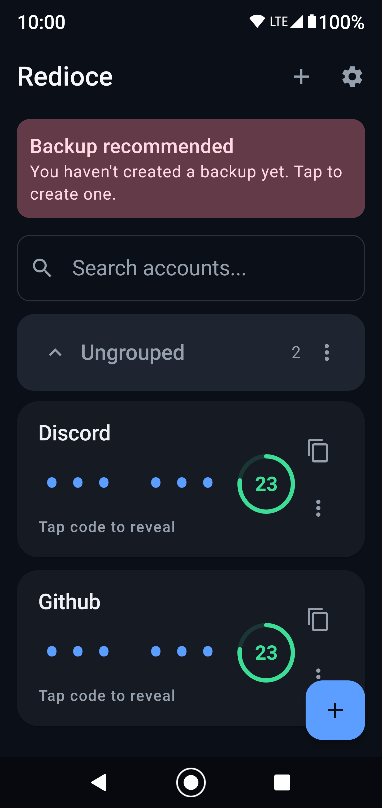
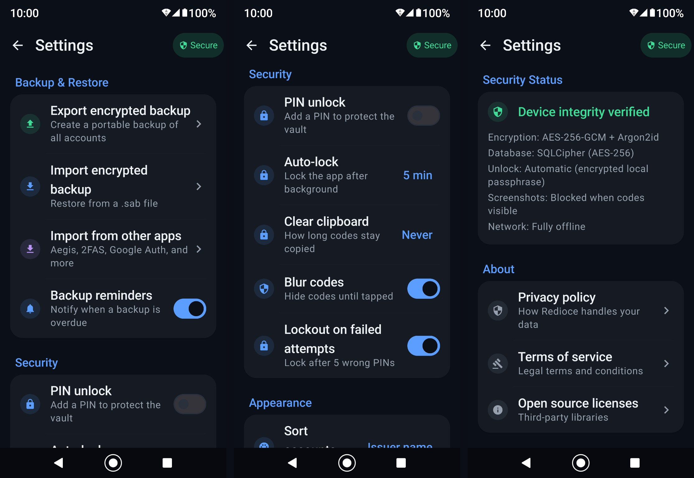

# Redioce

**A fully offline, privacy-first TOTP/HOTP authenticator for Android 8.0+.**

Redioce is a secure two-factor authentication app designed to keep your accounts private. It works entirely offline, encrypts stored secrets using Android Keystore-backed keys, and provides encrypted backups protected by a unique 256-bit recovery key.

## Features

- **TOTP & HOTP:** RFC 6238 and RFC 4226 support with SHA1, SHA256, and SHA512.
- **QR Scanning:** Offline QR detection using CameraX and ML Kit.
- **Manual Entry:** Supports `otpauth://` URIs and manual secret entry.
- **Encrypted Storage:** SQLCipher AES-256 database encryption.
- **Hardware Security:** Android Keystore, StrongBox preference, and hardware attestation.
- **Biometric Lock:** Class 3 biometrics with device credential fallback.
- **Encrypted Backups:** AES-256-GCM with Argon2id key derivation.
- **Privacy Protection:** Screenshot blocking, clipboard auto-clear, and hidden OTP codes.
- **Fully Offline:** No internet permission, telemetry, ads, or trackers.
- **Modern UI:** Material You theming, account search, and sorting.

## Security Architecture

| Component | Technology |
|---|---|
| Database | SQLCipher AES-256 |
| Key Storage | Android Keystore / StrongBox |
| Backup Encryption | AES-256-GCM |
| Key Derivation | Argon2id |
| OTP Generation | HMAC-SHA1/256/512 |
| Authentication | PinCode |

### Backup Cryptography

- **Recovery Key:** 256-bit
- **Salt:** 32 random bytes
- **Nonce:** 12 random bytes
- **KDF:** Argon2id (64 MB memory, 3 iterations, 4 lanes)
- **Encryption:** AES-256-GCM with a 128-bit authentication tag

## Screenshots

## Installation

Download the latest APK from [GitHub Releases](../../releases).

1. Enable installation from unknown sources.
2. Install the downloaded APK.
3. Launch Redioce.

**Requirements:** Android 8.0 (API 26)+, ARM64 or ARMv7. Camera access is optional.

## Usage

### Adding Accounts

- Scan a QR code using the camera.
- Manually enter the account name, issuer, secret, and OTP configuration.

### Generating Codes

OTP codes refresh automatically according to the configured period. Copied codes are automatically cleared after 30 seconds.

### Managing Accounts

Search, sort, and delete accounts directly from the home screen.

## Backup & Restore

Redioce supports encrypted `.sab` backups.

### Creating a Backup

1. Open **Settings → Export Encrypted Backup**.
2. Create a backup.
3. Save the displayed 256-bit recovery key securely.
4. Save or share the encrypted backup file.

### Restoring a Backup

1. Select your `.sab` file.
2. Enter its recovery key.
3. Decrypt and import your accounts.

**Important:** Recovery keys are never stored by Redioce. Losing your key means losing access to that backup permanently.

## Threat Model

Redioce protects against:

- Network-based attacks through the absence of internet permission.
- Database and backup theft through encryption.
- Unauthorized access through pin code authentication.
- Screenshot capture and clipboard snooping.
- Casual root-level attacks through heuristic and attestation checks.

**Limitations:** Redioce cannot guarantee protection against compromised Android systems, malicious firmware, advanced root-level instrumentation, memory extraction, or physical coercion. Device security and recovery key storage remain important.
